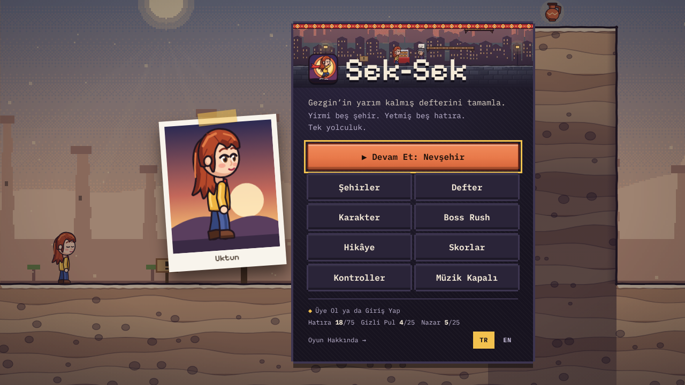
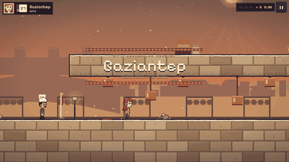
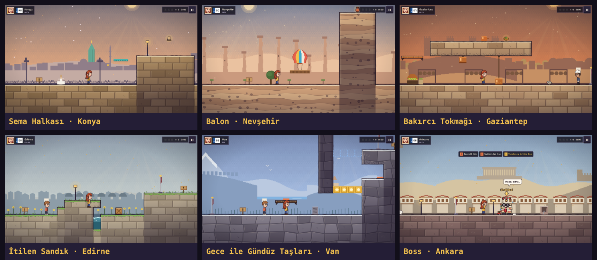
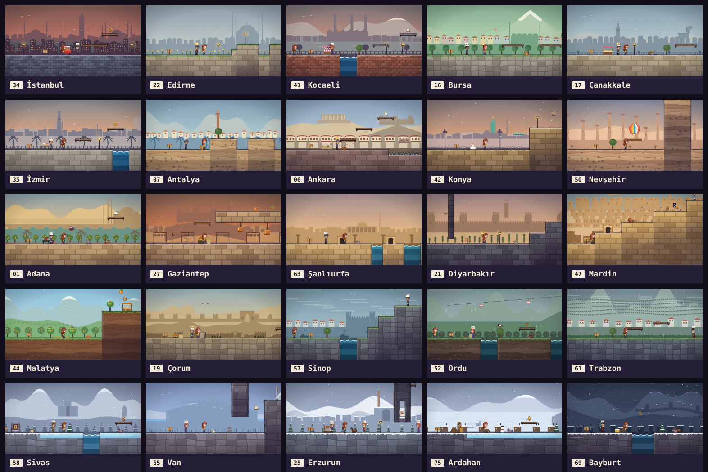
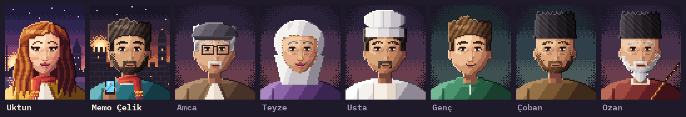
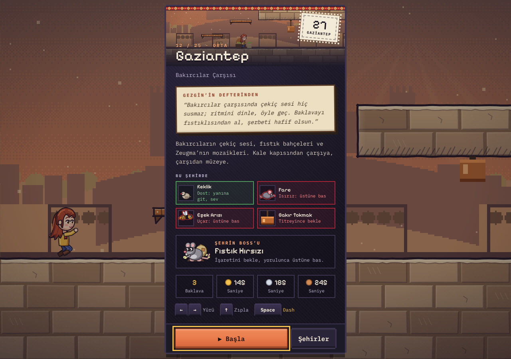
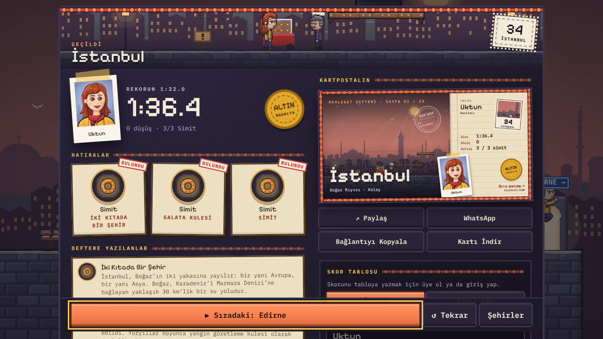
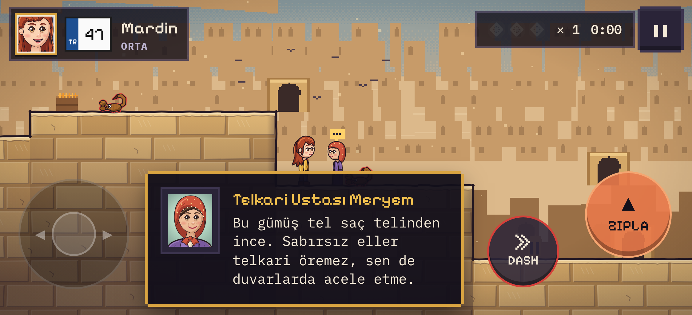
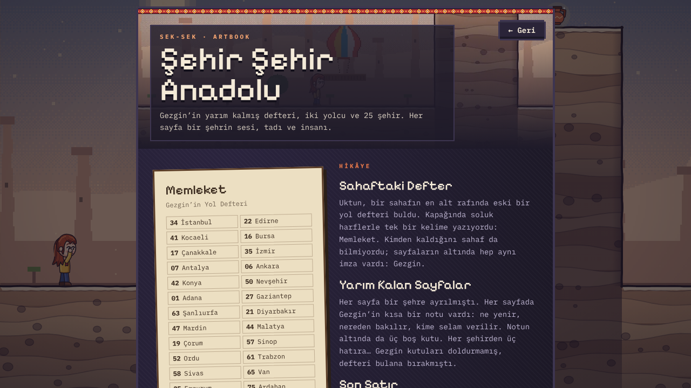
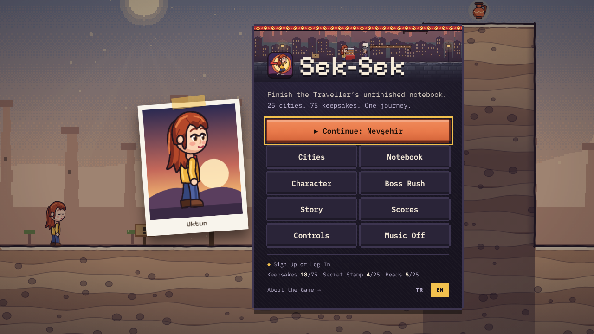

<div align="center">

# Sek-Sek · Şehir Şehir Anadolu

**Gezgin’in yarım kalmış defterini tamamla. Yirmi beş şehir, yetmiş beş hatıra, tek yolculuk.**

İstanbul’dan Bayburt’a, her şehri kendi sesi, tadı ve insanıyla aşan bir platform oyunu.<br>
Telefonda ve tarayıcıda oynanır; Türkçe ve İngilizce.

[**▶ Hemen Oyna · sek-sek.vercel.app**](https://sek-sek.vercel.app)



</div>

---

## Bir Bakışta



- **25 Şehir, Her Biri Kendine Has.** Trabzon’da ritimle zıplayan horon halkası, Konya’da dönen sema halkaları, Kapadokya’da binince yükselen balonlar,
  Gaziantep’te ritimle inen bakırcı tokmakları, Ardahan’da buz delikleri, Bayburt’ta karşı rüzgâr.
- **Gerçek Bilgiler.** Her hatıra o şehre dair doğrulanmış bir bilgi kartı açar; her şehirde saklı bir
  **gizli pul** deftere gizli bir sayfa ekler.
- **Konuşan Şehir.** Simitçiden vapur kaptanına, mırracıdan kangal sahibine 30’u aşkın şehir insanı.
  Dost hayvanları sevebilirsin; kırmızı hatla parlayan canlılar tehlikelidir.
- **Bulmacalar.** Anahtar ve kapı, basınç plakasıyla yer değiştiren bloklar, sahte duvarlar, kristallerle havada ikinci dash.
- **Artbook Havası.** Işıkla boyanmış portreler, kilim çerçeveler, defter kâğıdı kartlar, paylaşılabilir kartpostallar.
- **Skor Tablosu.** Şehir başına ve genel sıralama; altın, gümüş ve bronz süre madalyaları.

<br clear="right">



## Rota



| # | Şehir | Plaka | Zorluk | Kendine Has | Hatıra |
|---|-------|:-----:|--------|-------------|--------|
| 1 | İstanbul · Boğaz Kıyısı | 34 | Kolay | Zıplama, iskele platformu, vapur seferi | Simit |
| 2 | Edirne · Selimiye ve Kırkpınar | 22 | Kolay | Karaağaç garı, Meriç Köprüsü, çarşı, Selimiye; itilen sandıklar | Meyve Sabunu |
| 3 | Kocaeli · Körfez ve SEKA | 41 | Kolay | Körfez kıyısı, SEKA rıhtımı, anahtarlı depo | Pişmaniye |
| 4 | Bursa · Yeşil Bursa | 16 | Kolay | Cumalıkızık, Koza Han, teleferik; Karagöz’ün gölge platformları | Kestane Şekeri |
| 5 | Çanakkale · Boğaz ve Truva | 17 | Kolay | Kordon, Boğaz feribotu, Kilitbahir, Truva’nın katmanları | Testi |
| 6 | İzmir · Kordon Boyu | 35 | Kolay | Kordon yengeçleri, Kemeraltı tenteleri, Tarihi Asansör | Boyoz |
| 7 | Antalya · Falezler ve Şelale | 07 | Orta | Kaleiçi, Hadrian Kapısı, falezler, Düden’in ıslak taşları | Portakal |
| 8 | Ankara · Kale ve Cumbalar | 06 | Orta | Cumbalı balkonlar, kale burcunda tırmanış, koç | Tiftik |
| 9 | Konya · Mevlâna’nın Şehri | 42 | Orta | Dönen sema halkaları, Alaeddin Tepesi, Karatay’ın anahtarı | Sikke |
| 10 | Nevşehir · Kapadokya | 50 | Orta | Sıcak hava balonları, Derinkuyu tünelleri, çatlak köprü | Testi |
| 11 | Adana · Seyhan ve Taşköprü | 01 | Orta | Taşköprü, Seyhan bentleri, sivrisinekler | Pamuk |
| 12 | Gaziantep · Bakırcılar Çarşısı | 27 | Orta | Bakırcı tokmakları, fıstık bahçesi, Zeugma’nın düğmeleri | Baklava |
| 13 | Şanlıurfa · Balıklıgöl ve Göbeklitepe | 63 | Orta | Balıklıgöl, kale, Harran evleri, Göbeklitepe’nin taşları | İsot |
| 14 | Diyarbakır · Bazalt Surlar | 21 | Orta | Bazalt surlar, On Gözlü Köprü, Hevsel Bahçeleri, burç tırmanışı | Karpuz |
| 15 | Mardin · Taş Teraslar | 47 | Orta | Taş teraslar, dağılan taşlar, gizli mahzen | Telkari |
| 16 | Malatya · Kayısı Bahçeleri | 44 | Orta | Kayısı kasaları, arılar, Aslantepe | Kayısı |
| 17 | Çorum · Hattuşa Surları | 19 | Zor | Hitit ok tuzakları, Yerkapı tüneli, Aslanlı Kapı | Leblebi |
| 18 | Sinop · En Kuzeydeki Liman | 57 | Zor | Kale surları, balıkçı limanı, Hamsilos koyu, İnceburun feneri | Gemi Maketi |
| 19 | Ordu · Fındık ve Boztepe | 52 | Zor | Dalgalı sahil, fındık yamaçları, Boztepe teleferiği | Fındık |
| 20 | Trabzon · Horon ve Yayla | 61 | Zor | Horon halkası, çay terasları, Sümela kayalığı, Uzungöl | Sütlaç |
| 21 | Sivas · Buzlu Kızılırmak | 58 | Zor | Kaygan buz, kurtlar, Gök Medrese bilmecesi | Kangal rozeti |
| 22 | Van · Göl ve Kale | 65 | Zor | Van Kalesi, göl kıyısı, Akdamar; gece ile gündüz taşları | Otlu Peynir |
| 23 | Erzurum · Dadaş Diyarı | 25 | Zor | Medrese, kümbetler, Palandöken buzu, cirit meydanı | Oltu Taşı |
| 24 | Ardahan · Donmuş Çıldır | 75 | Zor | Donmuş Çıldır Gölü, buz delikleri, rüzgâr | Kızak Çanı |
| 25 | Bayburt · Kale ve Fırtına | 69 | Çok Zor | Karşı rüzgâr, Çoruh salları, kale burcu | Kopuz |

## Yolcular ve Şehir İnsanları



**Uktun**, İstanbullu bir haritacı; **Memo**, Diyarbakırlı bir telefoncu. İkisinden biri, bir sahafta “Gezgin” imzalı
eski bir yol defteri bulur; kapağında “Memleket” yazar. Her sayfa bir şehre ayrılmış, son sayfada tek bir cümle var:
“Yolun sonu, başladığım yer.”

Portreler vesikalık kadrajında, oyundaki karakterlerle aynı elle çizilmiş çizgiyle (`game/portraitDraw.ts`) çizilir;
menüde göz kırpar, seçtiğin atkı rengini taşır.

## Ekranlar

<table>
<tr>
<td width="50%"><br><sub>Her şehrin girişinde Gezgin’in notu ve <b>Bu Şehirde</b> rehberi: kim dost, kim tehlikeli.</sub></td>
<td width="50%"><br><sub>Bölüm sonu: süre ve madalya, bulunan hatıralar, kartpostal, skor tablosu.</sub></td>
</tr>
<tr>
<td><br><sub>Telefonda yatay: diyalog iki kontrolün arasına oturur, karakteri kapatmaz.</sub></td>
<td><br><sub>“Oyun Hakkında” menüden açılan bir artbook: Hikâye, Yolcular, Rota, Küçük Bir Sözlük.</sub></td>
</tr>
</table>

<p align="center"><br><sub>Başlık ekranındaki TR / EN düğmesiyle bütün oyun İngilizceye geçer.</sub></p>

## Kontroller

| | Hareket | Zıpla | Dash at | Diğer |
|---|---|---|---|---|
| **Klavye** | ← → · A D | ↑ · W · Z (basılı tut, daha yükseğe) | Space · X · Shift (8 yöne) | ↓ ince platformdan in · Esc mola · R bayraktan dön |
| **Dokunmatik** | Sol yarıda yüzen joystick | ZIPLA | DASH (joystick yönünde) | Büyük tuş seçeneği |
| **Oyun kolu** | Sol çubuk | A · Y | X · B · RT | |

Duvara doğru basılı tutup zıplarsan tırmanırsın. Dash yere değince ya da bir düşmana basınca yenilenir:
atkın kırmızıysa hazırsın, griyse harcadın.

## Geliştirme

```bash
npm install
cp .env.example .env.local   # DATABASE_URL (Neon)
npm run db:migrate           # seksek_* tablolarını oluşturur (oyunun kendi Neon veritabanı)
npm run dev
```

| Komut | Ne Yapar |
|-------|----------|
| `npm run typecheck` | TypeScript |
| `npm test` | Fizik, mekanik ve bölüm verisi testleri (vitest) |
| `npm run verify:levels` | Her bölümü gerçek fizik motoruyla oynayan çözücü: çıkış, her hatıra, bayrak, anahtar ve gizli pul ulaşılabilir mi |
| `npm run build` | Üretim derlemesi |

Claude ya da başka bir ajanla çalışıyorsan önce **[CLAUDE.md](CLAUDE.md)**: kurallar, proje haritası, yeni şehir
ekleme adımları ve öğrenilmiş tasarım tuzakları orada. Bölüm tasarımı için `.claude/agents/level-designer.md`.

```text
game/          DOM'suz oyun çekirdeği: fizik (sim), bölümler, çizim, ses, karakterler, portreler, İngilizce metinler
components/    React arayüzü: bütün ekranlar, artbook, şehir rehberi, diyalog, HUD, dokunmatik kontroller
lib/           kayıt ve harita sürümü, TR/EN, paylaşım, veritabanı
app/           / oyun · /hakkinda · /skor paylaşım sayfası · /skor/kart kartpostal · /api skor ve oyuncu
scripts/       verify-levels çözücü, migrate, art/ (portre, çizim föyleri, şehir kartları, harita üreteçleri)
tests/         fizik ve mekanik testleri
```

Her şey kodla üretilir: harici sprite ya da ses dosyası yoktur. Müzik her şehrin makamında, oynarken WebAudio ile çalınır.

**Teknoloji:** Next.js 16 · React 19.2 · TypeScript · Tailwind CSS v4 · kendi canvas motoru (120 Hz sabit adım) ·
Neon + Drizzle · Vercel.

---

<div align="center"><sub>Tasarım ve geliştirme: Ahmet Akyapı</sub></div>
