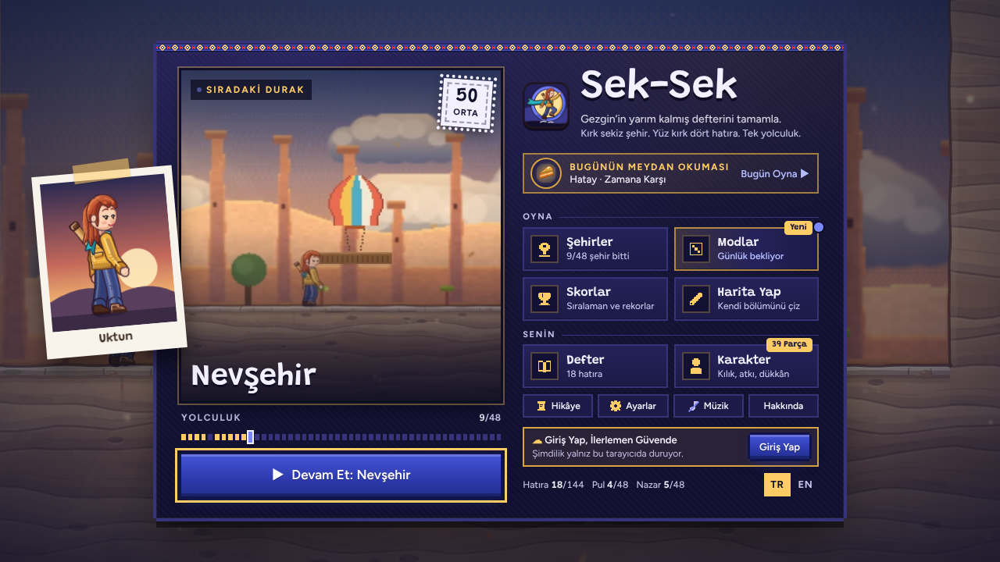
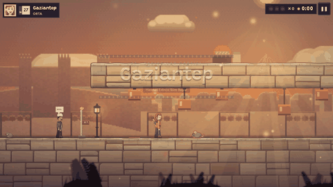
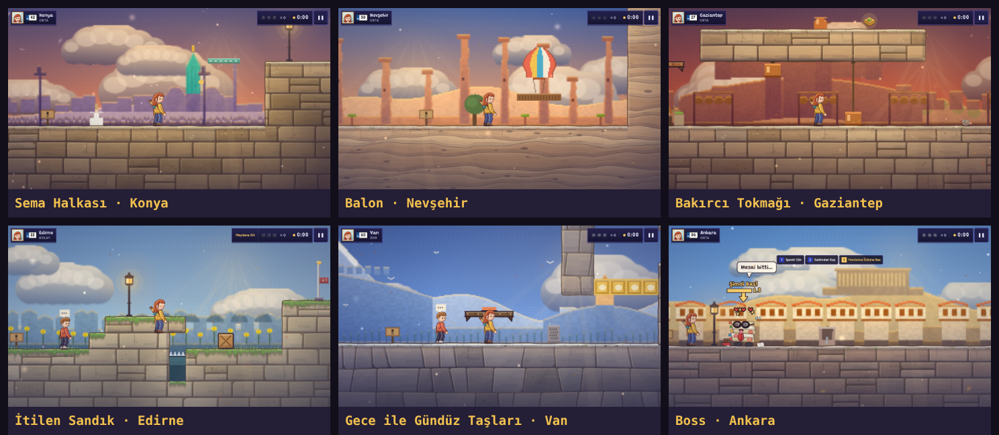
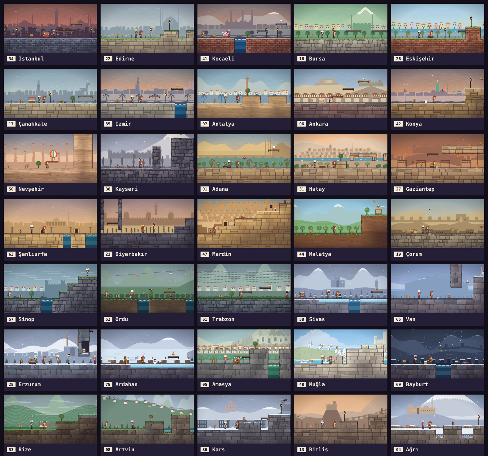
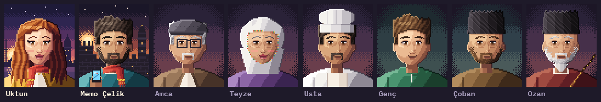
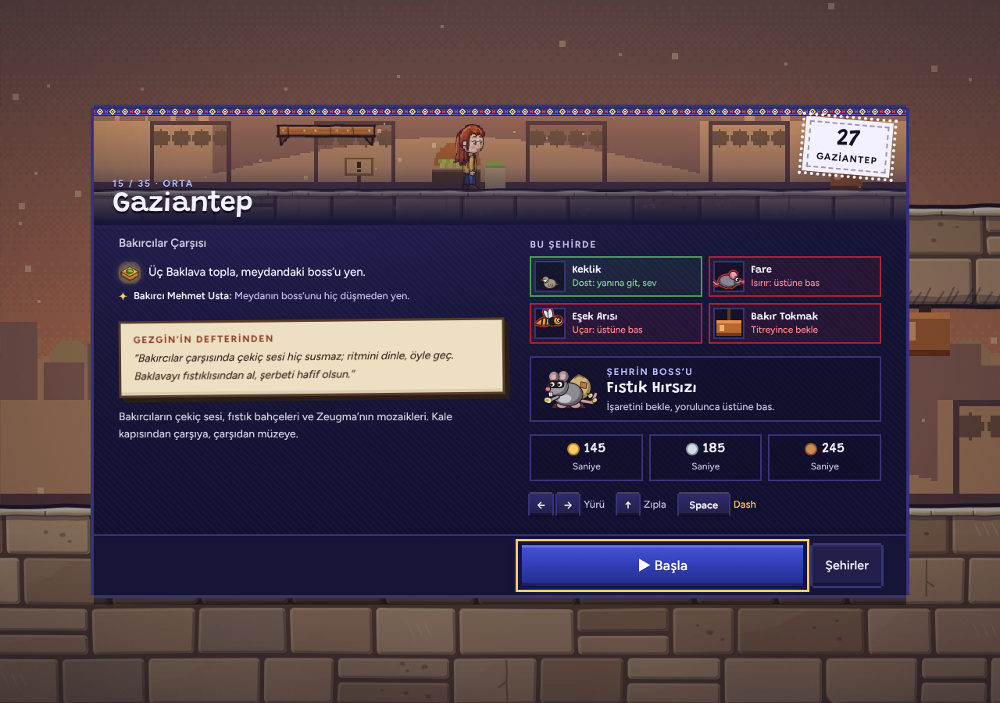
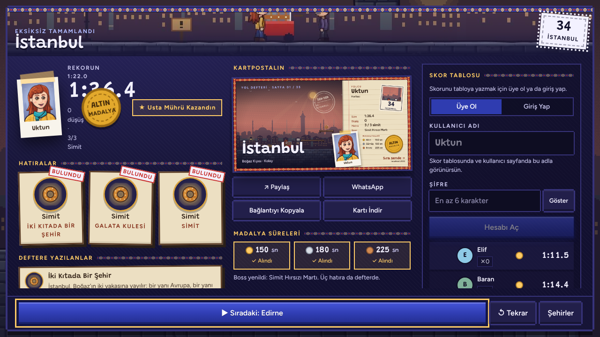
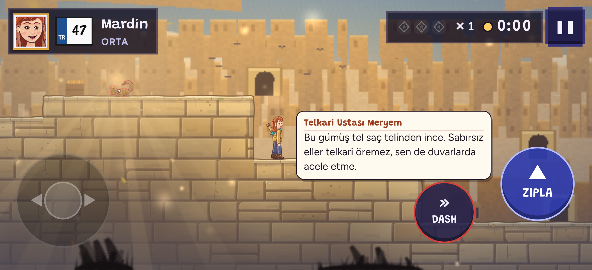
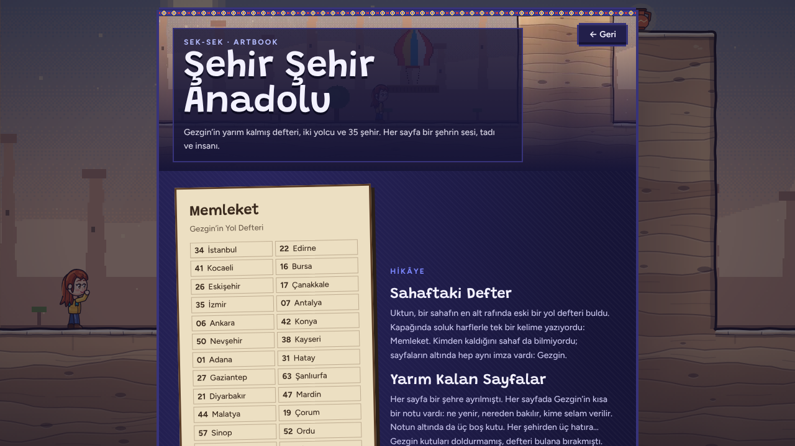
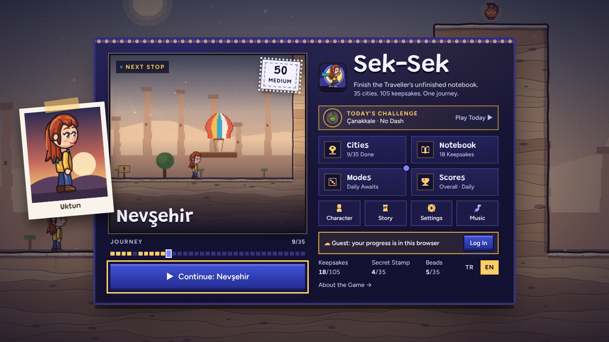

<div align="center">

# Sek-Sek · Şehir Şehir Anadolu

**Gezgin’in yarım kalmış defterini tamamla. Kırk sekiz şehir, yüz kırk dört hatıra, iki defter, tek yolculuk.**

İstanbul’dan Kastamonu’ya, her şehri kendi sesi, tadı ve insanıyla aşan, el boyaması görünümlü sakin bir platform oyunu.<br>
Telefonda ve tarayıcıda oynanır; Türkçe ve İngilizce.

[**▶ Hemen Oyna · sek-sek.vercel.app**](https://sek-sek.vercel.app)



</div>

---

## Bir Bakışta



- **48 Şehir, İki Defter.** Trabzon’da ritimle zıplayan horon halkası, Konya’da dönen sema halkaları, Kapadokya’da binince yükselen balonlar,
  Gaziantep’te ritimle inen bakırcı tokmakları, Bayburt’ta karşı rüzgâr. İkinci defterde Rize’de derede yüzme, Artvin’de köy
  teleferikleri, Mersin’de gelgit, Balıkesir’de yükselen sıcak hava, Elazığ’da saat gibi donup eriyen su, Afyon’un havuz teyzeleri,
  Bingöl’ün batan yüzen adaları, Adıyaman’da Nemrut’un taş başları ve Kastamonu’da içine gireni aşağı çeken şelaleler.
- **El Boyaması Görünüm.** Boyalı arka planlar, altın saat ışığı, havada süzülen yapraklar; karakterler, boss’lar ve zemin
  ekran çözünürlüğünde vektör çizilir. Müzik davulsuz ve sakin (keçeli piyano, ney, kanun, müzik kutusu), altında şehrin doğa sesi.
- **Gerçek Bilgiler.** Her hatıra o şehre dair doğrulanmış bir bilgi kartı açar; her şehirde saklı bir **gizli pul** ve
  meydan yolunda bir **nazar boncuğu** var.
- **Konuşan Şehir.** Simitçiden vapur kaptanına 200’ü aşkın şehir insanı; Hikâye Gezisi’nde onlarla sohbet edip defter sayfası kazanırsın.
  Dost hayvanları sevebilirsin; kırmızı hatla parlayan canlılar tehlikelidir.
- **Boss’lar.** Her şehrin sonunda o şehrin bir ayrıntısından doğan bir boss: Galata Martısı, Diyojen’in Fıçısı, Nemrut’un Taş Kartalı,
  Taşköprü Sarımsağı… Kural hep aynı: işareti gör, saldırıdan kaç, yorulunca üstüne bas.
- **Mücadeleler.** Zor şehirlerin en sıkı kesitleri, elle çizilmiş Usta Parkurları ve onların üstünde yeni Efsane Parkurları;
  altın, gümüş, bronz madalya ve parkur başına sıralama. Haftalık Turnuva ve Günün Üçlüsü.
- **Modlar.** Günlük Meydan Okuma, Düello (yan yana bölünmüş ekran), Co-op (iki kişi aynı ekranda; kurtarma, eşi fırlatma),
  Boss Rush, Maraton, Kovalamaca, Ayna Yolu, Speedrun, Sakin Gezi, Gezgin Turu ve Hikâye Gezisi.
- **Sinir Bozucu.** Yirmi üç zor mod (Cehennem Yolu, Kaygan Dünya, Ters Tuşlar, Çöken Dünya, Ağır Yerçekimi, Af Yok…) ve elle
  çizilmiş Öfke Parkurları. Hikâyeye ve ilerlemeye dokunmaz.
- **Mağaza.** İki yolcuyu ayrı giydir: saç, ten, göz, kıyafet rengi ve deseni, ifade, bekleme duruşu, koşu tarzı, baş, yüz ve
  sırt aksesuarları, atkı rengi. Karakteri 360° döndürüp önden ve arkadan bak.
- **Skor Tablosu.** Genel, şehirler, günlük, modlar, Speedrun, koleksiyon ve arkadaşlar; yolcuya tıklayınca profil ayrıntısı,
  rakibin hayaletiyle yarış.
- **Bölüm Düzenleyici.** 600 sütuna dek harita, oyunun kendi görünüşünde çizim, hazır parçalar, şablonlar, boss tasarımcısı;
  çözücüyle sına, bağlantıyla paylaş, topluluğa yayınla.
- **Erişilebilirlik.** Renk körü paleti, büyük yazı, kamera yakınlığı, ekran sarsıntısı varsayılan kapalı, Rahat Mod, tuş atama,
  dokunmatik ve oyun kolu.
- **Güncelleme hiçbir şeyi silmez.** Bir şehrin haritası yenilense de rekorun, hatıraların ve sıralaman durur; giriş yapınca ilerlemen
  buluta yedeklenir.

<br clear="right">



## Rota



| # | Şehir | Plaka | Zorluk | Kendine Has | Hatıra |
|---|-------|:-----:|--------|-------------|--------|
| 1 | İstanbul · Boğaz Kıyısı | 34 | Kolay | Zıplama, iskele platformu, vapur seferi | Simit |
| 2 | Edirne · Selimiye ve Kırkpınar | 22 | Kolay | Karaağaç garı, Meriç Köprüsü, çarşı, Selimiye; itilen sandıklar | Meyve Sabunu |
| 3 | Kocaeli · Körfez ve SEKA | 41 | Kolay | Körfez kıyısı, SEKA rıhtımı, anahtarlı depo | Pişmaniye |
| 4 | Bursa · Yeşil Bursa | 16 | Kolay | Cumalıkızık, Koza Han, teleferik; Karagöz’ün gölge platformları | Kestane Şekeri |
| 5 | Eskişehir · Porsuk’un Kıyısı | 26 | Kolay | Odunpazarı, Porsuk gondolları, Sazova şatosu, Kurşunlu | Lületaşı |
| 6 | Çanakkale · Boğaz ve Truva | 17 | Kolay | Kordon, Boğaz feribotu, Kilitbahir, Truva’nın katmanları | Testi |
| 7 | İzmir · Kordon Boyu | 35 | Kolay | Kordon yengeçleri, Kemeraltı tenteleri, Tarihi Asansör | Boyoz |
| 8 | Antalya · Falezler ve Şelale | 07 | Orta | Kaleiçi, Hadrian Kapısı, falezler, Düden’in ıslak taşları | Portakal |
| 9 | Ankara · Kale ve Cumbalar | 06 | Orta | Cumbalı balkonlar, kale burcunda tırmanış, koç | Tiftik |
| 10 | Konya · Mevlâna’nın Şehri | 42 | Orta | Dönen sema halkaları, Alaeddin Tepesi, Karatay’ın anahtarı | Sikke |
| 11 | Nevşehir · Kapadokya | 50 | Orta | Sıcak hava balonları, Derinkuyu tünelleri, çatlak köprü | Testi |
| 12 | Kayseri · Erciyes’in Eteği | 38 | Orta | Kale surları, Kapalı Çarşı, Gevher Nesibe, Erciyes eteği | Mantı |
| 13 | Adana · Seyhan ve Taşköprü | 01 | Orta | Taşköprü, Seyhan bentleri, sivrisinekler | Pamuk |
| 14 | Hatay · Medeniyetler Kavşağı | 31 | Orta | Uzun Çarşı, Senpiyer kayası, Asi’nin su dolapları, Harbiye | Künefe |
| 15 | Gaziantep · Bakırcılar Çarşısı | 27 | Orta | Bakırcı tokmakları, fıstık bahçesi, Zeugma’nın düğmeleri | Baklava |
| 16 | Şanlıurfa · Balıklıgöl ve Göbeklitepe | 63 | Orta | Balıklıgöl, kale, Harran evleri, Göbeklitepe’nin taşları | İsot |
| 17 | Diyarbakır · Bazalt Surlar | 21 | Orta | Bazalt surlar, On Gözlü Köprü, Hevsel Bahçeleri, burç tırmanışı | Karpuz |
| 18 | Mardin · Taş Teraslar | 47 | Orta | Taş teraslar, dağılan taşlar, gizli mahzen | Telkari |
| 19 | Malatya · Kayısı Bahçeleri | 44 | Orta | Kayısı kasaları, arılar, Aslantepe | Kayısı |
| 20 | Çorum · Hattuşa Surları | 19 | Zor | Hitit ok tuzakları, Yerkapı tüneli, Aslanlı Kapı | Leblebi |
| 21 | Sinop · En Kuzeydeki Liman | 57 | Zor | Kale surları, balıkçı limanı, Hamsilos koyu, İnceburun feneri | Gemi Maketi |
| 22 | Ordu · Fındık ve Boztepe | 52 | Zor | Dalgalı sahil, fındık yamaçları, Boztepe teleferiği | Fındık |
| 23 | Trabzon · Horon ve Yayla | 61 | Zor | Horon halkası, çay terasları, Sümela kayalığı, Uzungöl | Sütlaç |
| 24 | Sivas · Buzlu Kızılırmak | 58 | Zor | Kaygan buz, kurtlar, Gök Medrese bilmecesi | Kangal rozeti |
| 25 | Van · Göl ve Kale | 65 | Zor | Van Kalesi, göl kıyısı, Akdamar; gece ile gündüz taşları | Otlu Peynir |
| 26 | Erzurum · Dadaş Diyarı | 25 | Zor | Medrese, kümbetler, Palandöken buzu, cirit meydanı | Oltu Taşı |
| 27 | Ardahan · Donmuş Çıldır | 75 | Zor | Donmuş Çıldır Gölü, buz delikleri, rüzgâr | Kızak Çanı |
| 28 | Amasya · Yeşilırmak’ın İki Yakası | 5 | Çok Zor | Yalıboyu evleri, kral kaya mezarları, Ferhat’ın su kanalı, Bayezid Külliyesi | Elma |
| 29 | Muğla · Bodrum’dan Ölüdeniz’e | 48 | Çok Zor | Bodrum Kalesi, yel değirmenleri, Dalyan kaya mezarları, Ölüdeniz; arkadan esen meltem | Sünger |
| 30 | Bayburt · Kale ve Fırtına | 69 | Çok Zor | Karşı rüzgâr, Çoruh salları, kale burcu | Kopuz |
| | **İkinci Defter** | | | | |
| 31 | Rize · Çay Bahçelerinden Yaylaya | 53 | Orta | Çay terasları, Fırtına Deresi’nde yüzme, taş kemer köprüler, Zil Kale | Çay |
| 32 | Artvin · Çoruh’un Yamaçları | 08 | Zor | Köy teleferikleri, sarkan halatlar, Çoruh vadisi, Kafkasör Yaylası | Bal Peteği |
| 33 | Kars · Ani’den Sarıkamış’a | 36 | Zor | Taş bina saçakları, kale halatları, buzlu Sarıkamış yamacı, Ani harabeleri | Gravyer |
| 34 | Bitlis · Vadideki Kale, Kraterdeki Göl | 13 | Zor | Kale halatları, Ahlat mezar taşları, Nemrut krater gölünde yüzme | Büryan |
| 35 | Ağrı · Sarayın Kapısından Dağın Zirvesine | 04 | Çok Zor | İshak Paşa Sarayı halatları, Meteor Çukuru teleferiği, buzlu yamaç, karşı rüzgâr | Kilim |
| 36 | Giresun · Kirazın Adını Verdiği Şehir | 28 | Orta | Zeytinlik damları, kale burçları, fındık bahçesinde nitro, sahilde kayıklar | Kiraz |
| 37 | Tokat · Kalıptan Çıkan Desenler | 60 | Zor | Taşhan, kale halatları, yazma kalıplarının tokmakları, Zile surları | Yazma |
| 38 | Denizli · Pamuk Kale’nin Beyaz Basamakları | 20 | Çok Zor | Horozlu meydan, Laodikeia sütunları, kaygan travertenler, Hierapolis tiyatrosu | Havlu |
| 39 | Zonguldak · Denizin Dibi, Ocağın Derini | 67 | Zor | Maden ocağı, denizde yüzme, nefes, Cehennemağzı | Madenci Lambası |
| 40 | Mersin · Gelgit, Kale ve Obruk | 33 | Orta | Gelgit suyu, Kızkalesi, Cennet ve Cehennem obrukları, Tarsus | Cezerye |
| 41 | Karabük · Konak, Kanyon ve Çelik | 78 | Çok Zor | Safranbolu çarşısı, cam yol, haddehane tokmakları | Safran |
| 42 | Aydın · Efes’in Sütunları | 09 | Çok Zor | Mermer Cadde, tiyatronun ritim sıraları, Didim, Nysa tüneli | İncir |
| 43 | Balıkesir · Termal, Zeytin ve Kuşlar | 10 | Zor | Yükselen sıcak havayla uçuş, Şeytan Sofrası, Hasanboğuldu, Kuşcenneti | Höşmerim |
| 44 | Elazığ · Süt Kalesi, Buzluk ve Hazar | 23 | Çok Zor | Saat gibi donup eriyen su, Harput Kalesi, yeraltında Buzluk Mağarası, Hazar’ın batık şehri | Orcik |
| 45 | Afyon · Kara Kale, Kaymak ve Kaplıca | 03 | Zor | Termal otel: döner kapı, açık büfe, buhar odası; havuz teyzelerine görünmeden geç | Kaymak |
| 46 | Bingöl · Bin Göl ve Yüzen Adalar | 12 | Zor | Üstüne basınca batan yüzen adalar, Çır Şelalesi, arılı yayla | Bingöl Balı |
| 47 | Adıyaman · Nemrut’un Taş Başları | 2 | Orta | Cendere Köprüsü, Perre’nin kaya mezarları, Nemrut’un yarığı ve devrik taş başlar | Çiğ Köfte |
| 48 | Kastamonu · Kale, Hasır ve Şelaleler | 37 | Zor | İçine gireni aşağı çeken şelaleler, kale burcu, Ilgaz’ın karlı ormanı, Horma Kanyonu | Etli Ekmek |

## Yolcular ve Şehir İnsanları



**Uktun**, İstanbullu bir haritacı; **Memo**, Diyarbakırlı bir telefoncu. İkisinden biri, bir sahafta “Gezgin” imzalı
eski bir yol defteri bulur; kapağında “Memleket” yazar. Her sayfa bir şehre ayrılmış, son sayfada tek bir cümle var:
“Yolun sonu, başladığım yer.”

Portreler vesikalık kadrajında, oyundaki karakterlerle aynı elle çizilmiş çizgiyle (`game/portraitDraw.ts`) çizilir;
menüde göz kırpar, seçtiğin atkı rengini taşır.

## Ekranlar

<table>
<tr>
<td width="50%"><br><sub>Her şehrin girişinde Gezgin’in notu ve <b>Bu Şehirde</b> rehberi: kim dost, kim tehlikeli.</sub></td>
<td width="50%"><br><sub>Bölüm sonu: süre ve madalya, bulunan hatıralar, kartpostal, skor tablosu.</sub></td>
</tr>
<tr>
<td><br><sub>Telefonda yatay: diyalog iki kontrolün arasına oturur, karakteri kapatmaz.</sub></td>
<td><br><sub>“Oyun Hakkında” menüden açılan bir artbook: Hikâye, Yolcular, Rota, Küçük Bir Sözlük.</sub></td>
</tr>
</table>

<p align="center"><br><sub>Başlık ekranındaki TR / EN düğmesiyle bütün oyun İngilizceye geçer.</sub></p>

## Kontroller

| | Hareket | Zıpla | Dash at | Diğer |
|---|---|---|---|---|
| **Klavye** | ← → · A D | ↑ · W · Z (basılı tut, daha yükseğe) | Space · X (8 yöne) | ↓ ince platformdan in · Esc mola · R bayraktan dön · tuşlar Ayarlar'dan değişir |
| **Dokunmatik** | Sol yarıda yüzen joystick | ZIPLA | DASH (joystick yönünde) | Büyük tuş seçeneği |
| **Oyun kolu** | Sol çubuk | A · Y | X · B · RT | Start mola · destekleyen kollarda titreşim |

Duvara doğru basılı tutup zıplarsan tırmanırsın. Dash yere değince ya da bir düşmana basınca yenilenir:
atkın kırmızıysa hazırsın, griyse harcadın.

## Geliştirme

```bash
npm install
cp .env.example .env.local   # DATABASE_URL (Neon)
npm run db:migrate           # seksek_* tablolarını oluşturur (oyunun kendi Neon veritabanı)
npm run dev
```

| Komut | Ne Yapar |
|-------|----------|
| `npm run typecheck` | TypeScript |
| `npm test` | Fizik, mekanik ve bölüm verisi testleri (vitest) |
| `npm run verify:levels` | Her bölümü gerçek fizik motoruyla oynayan çözücü: çıkış, her hatıra, bayrak, anahtar ve gizli pul ulaşılabilir mi |
| `bash scripts/verify-all.sh <şehir>` | Bir şehrin bütün doğrulama zinciri: meydan yolu, yeniden doğuş, boss botu, zayıf oyuncu, düşmanlar |
| `npx tsx scripts/city-check.ts <şehir>` | Şehir oyunun her köşesine kayıtlı mı (metin, çizim, madalya, görsel) |
| `npm run build` | Üretim derlemesi |

Claude ya da başka bir ajanla çalışıyorsan önce **[CLAUDE.md](CLAUDE.md)**: altın kurallar, kısa proje haritası ve hangi iş için
hangi yetenek. Konu kuralları `.claude/rules/`, iş yolları `.claude/skills/` altında (yeni şehir, yeni mekanik, yeni mod, yeni parkur…).
Yeni şehrin iskeleti tek komutla kurulur: `npx tsx scripts/new-city.ts <id> --zorluk Orta`.

```text
game/          DOM'suz oyun çekirdeği: fizik (sim), bölümler, çizim, ses, karakterler, portreler, İngilizce metinler
components/    React arayüzü: bütün ekranlar, artbook, şehir rehberi, diyalog, HUD, dokunmatik kontroller
lib/           kayıt ve harita sürümü, TR/EN, paylaşım, veritabanı
app/           / oyun · /hakkinda · /skor paylaşım sayfası · /skor/kart kartpostal · /api skor ve oyuncu
scripts/       çözücü ve doğrulama botları, new-city iskelet, migrate, art/ (portre, çizim föyleri, şehir kartları, harita üreteçleri)
tests/         vitest: fizik, mekanik, boss, kamera, kayıt, skor API'si, hikâye, mücadeleler
```

Her şey kodla üretilir: harici sprite ya da ses dosyası yoktur. Müzik ve doğa sesi oynarken WebAudio ile üretilir.

**Teknoloji:** Next.js 16 · React 19.2 · TypeScript · Tailwind CSS v4 · kendi canvas motoru (120 Hz sabit adım) ·
Neon + Drizzle · Vercel.

---

<div align="center"><sub>Tasarım ve geliştirme: Ahmet Akyapı</sub></div>
